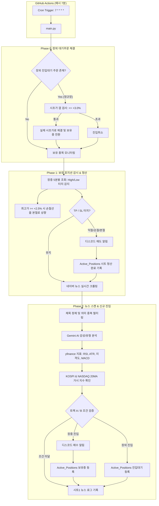

# 🚀 Serverless AI Trading Bot

> **GitHub Actions 기반 24/7 무중단 서버리스 퀀트/AI 자동 트레이딩 봇**  
> 실시간 네이버 뉴스 크롤링 + Google Gemini AI 감성 분석 + 야후 파이낸스 기술적 보조지표 + 구글 스프레드시트 DB + 디스코드 알림을 결합한 한국 주식 트레이딩 시스템입니다.

> [!NOTE]  
> 📊 **[현재까지 누적 수익률 분석 및 구조적 문제점 보고서 (docs/PERFORMANCE_AND_ISSUES.md)](docs/PERFORMANCE_AND_ISSUES.md)**  
> 8~10월 모의투자 실거래 9건에 대한 표면 성과(77.8%, +54.2%) vs 장외 체결 착시(Look-Ahead Bias) 분리 분석, 6주간 거래 공백(Filter Starvation) 등 규명된 문제점 및 해결책을 정리한 공식 문서입니다.

---

## 📌 주요 특징 (Key Features)

- **100% 서버리스(Serverless) 아키텍처**: 별도 클라우드 서버(EC2 등) 없이 **GitHub Actions Cron**으로 매시 7분마다 완전 무료 자동 실행
- **장외 체결 착시 방지 (Pending Order)**: 장외(15:20~09:00 KST)에 발생한 시그널은 `진입대기`로 보류 후, 익일 09:00 정규장 시초가 갭상승이 **+3.0% 이내**일 때만 실제 시세로 체결
- **2트랙 매매 전략 (이원화 진입)**:
  - **트랙 A (모멘텀 돌파)**: 촉매형 호재($\ge +7$) + 코스피/나스닥 20일선 위 + $RSI \le 65$ + 이격도 $< 115\%$ + MACD 골든크로스
  - **트랙 B (과매도 역발상)**: 극단적 과매도($RSI \le 35$) 구간에서 호재 발생 시 대세 하락장에서도 바닥 반등 매수 진입
- **철저한 리스크 관리**:
  - ATR 기반 동적 목표가/손절가 설정 (목표가 Max $+5.0\%$ / 손절가 Max $-3.0\%$, 손익비 1.67:1 고정)
  - **본절 스탑(Breakeven Ratchet)**: 최고 수익률 $+2.5\%$ 도달 시 손절선을 `매수가 × 1.003`(본절 + 수수료)로 자동 상향
  - **포지션 쿨다운**: 동일 종목 보유 중복 진입 차단 및 청산 후 24시간 내 재진입 방지
- **스마트 뉴스 크롤러 & 의미 중복 필터**:
  - 기사 제목 내 `"새 창 열림"` 등 불필요한 HTML 아티팩트 자동 제거
  - 최근 12시간 내 동일 종목 기사와 자카드 유사도(**Jaccard $\ge 0.4$**) 검사를 통한 타 언론사 동일 이슈 LLM 호출 70% 절감
  - 단순 시황 중계 기사(`market_recap`)와 미래 기업가치 변화 기사(`catalyst`) 자동 분류
- **구글 스프레드시트 API 최적화**: 분당 쓰기 제한(60회)을 준수하기 위해 개별 셀 수정 대신 `batch_update` 및 `append_rows` 일괄 배치 처리
- **60일 비활성화 자동 방지 (Keepalive)**: 2주마다 자동 커밋을 생성하는 Keepalive 워크플로우로 GitHub 스케줄러 자동 중단 방지

---

## 🏗️ 시스템 아키텍처



---

## 📂 프로젝트 구조

```
traiding_bot/
├── .github/
│   ├── heartbeat.txt                 # 60일 비활성화 방지용 하트비트 파일
│   └── workflows/
│       ├── trading_bot.yml           # 메인 트레이딩 봇 실행 워크플로우 (매시 7분)
│       ├── track_performance.yml     # 사후 1/3/5일 수익률 추적 워크플로우 (평일 16:00 KST)
│       └── keepalive.yml             # 60일 비활성화 방지 자동 커밋 워크플로우
├── tests/
│   ├── __init__.py
│   └── test_logic.py                 # 매매 알고리즘 및 필터 단위 테스트 (9개 테스트)
├── main.py                           # 봇 실행 메인 파이프라인 (Phase 0, 1, 2)
├── strategy.py                       # 순수 매매 알고리즘 (2트랙 판정, TP/SL 계산, 장외시간, 쿨다운)
├── dedup.py                          # 자카드 유사도 기반 의미 중복 기사 필터링
├── analyzer.py                       # Gemini API 감성 분석 및 기사 유형(catalyst/recap) 분류
├── chart.py                          # yfinance 실시간 시세, 5분봉, 지수 20일선, 기술지표 계산
├── crawler.py                        # 네이버 뉴스 크롤러 및 텍스트 전처리
├── db.py                             # Google Sheets(gspread) 배치 읽기/쓰기 인터페이스
├── notifier.py                       # 디스코드 웹훅 알림 카드 발송 모듈
├── track_performance.py              # 과거 뉴스 수집 건 사후 1/3/5일 수익률 자동 추적 스크립트
├── config.py                         # 전략 파라미터 및 환경 변수 설정
└── requirements.txt                  # 파이썬 의존성 패키지 목록
```

---

## ⚙️ 환경 변수 설정 (GitHub Secrets)

GitHub 레포지토리의 **Settings ➡️ Secrets and variables ➡️ Actions**에 아래 시크릿을 등록합니다:

| 시크릿 이름 | 필수 여부 | 설명 |
|---|---|---|
| `GEMINI_API_KEY` | **필수** | Google AI Studio에서 발급받은 Gemini API 키 |
| `GOOGLE_SERVICE_ACCOUNT_JSON` | **필수** | 구글 클라우드 콘솔에서 발급받은 서비스 계정 키 (JSON 원문 전체) |
| `GOOGLE_SPREADSHEET_ID` | **필수** | 연동할 구글 스프레드시트의 고유 ID (URL의 `/d/{ID}/edit` 부분) |
| `DISCORD_WEBHOOK_URL` | **선택** | 디스코드 통합 알림 웹훅 URL (단일 채널 사용 시) |
| `DISCORD_WEBHOOK_GENERAL` | **선택** | `#매수-진입-알림` 전용 디스코드 웹훅 URL |
| `DISCORD_WEBHOOK_SELL` | **선택** | `#매도-청산-알림` 전용 디스코드 웹훅 URL |

> [!TIP]
> 구글 스프레드시트를 생성한 후, 생성된 서비스 계정 이메일(`xxx@xxx.iam.gserviceaccount.com`)에 스프레드시트 **편집자(Editor)** 권한을 반드시 부여해야 합니다.

---

## 📊 구글 스프레드시트 스키마

### 1. `시트1` (뉴스 수집 및 사후 성과 검증 탭 - 총 16열)
| 열 번호 | 컬럼명 | 설명 |
|:---:|---|---|
| 1~4 | 일시, 검색 키워드, 뉴스 제목, URL | 수집 메타데이터 |
| 5~7 | AI 스코어, AI 요약, 주요 키워드 | Gemini LLM 분석 결과 |
| 8~10 | RSI, 이격도, MACD 상태 | 뉴스 발생 시점의 기술적 보조지표 |
| 11~12 | 진입가기준, 진입여부 | 수집 시점 주가 및 매매 판정 결과 (`Y-A`, `대기-A`, `N (사유)`) |
| 13~15 | 1일후수익률, 3일후수익률, 5일후수익률 | 장 마감 후 배치 스크립트가 추적 기입 |
| 16 | 최종결과 | 진행중, 익절, 손절, 미진입 |

### 2. `Active_Positions` (실시간 포지션 관리 탭 - 총 17열)
| 열 번호 | 컬럼명 | 설명 |
|:---:|---|---|
| 1~3 | 진입일자, 종목코드, 종목명 | 포지션 기본 정보 |
| 4~6 | 매수가, 목표가, 손절가 | 체결가 및 동적 TP/SL 수치 |
| 7 | 상태 | `보유중`, `진입대기`, `청산완료`, `진입취소` |
| 8~11 | 청산일자, 청산가, 청산사유, 수익률(%) | 청산 완료 시 기록되는 성과 데이터 |
| 12~13 | 최고가도달, 최고가도달률(%) | 트레일링/본절 스탑 감시용 최고가 추적 |
| 14~17 | 시그널가, 진입트랙, 최종점검시각, 비고 | 장외 시그널가, 트랙(`A`/`B`), 래칫 상태 메모 |

---

## 💻 로컬 개발 및 테스트

### 1. 의존성 설치
```powershell
pip install -r requirements.txt
```

### 2. 전략 및 필터 단위 테스트 실행 (네트워크 의존성 없음)
```powershell
python -m unittest tests/test_logic.py
```
> 장외시간 판정, 모멘텀/역발상 트랙 판정, 시초가 갭 검증, 본절 스탑 래칫, 의미 중복 토큰화, 24시간 쿨다운 등 9개 핵심 테스트가 0.01초 내에 검증됩니다.

### 3. 드라이런 (Dry-Run) 모의 실행
실제 구글 시트 쓰기 및 디스코드 발송을 생략하고 전체 파이프라인(크롤링 ➡️ 분석 ➡️ 보조지표 ➡️ 판정)만 테스트합니다:
```powershell
python main.py --dry-run
```

### 4. 과거 뉴스 사후 성과 추적 배치 수동 실행
```powershell
python track_performance.py
```

---

## 📈 매매 전략 파라미터 (config.py)

```python
# 정규장 및 장외 대기 시간
MARKET_OPEN_HHMM = (9, 0)
MARKET_ENTRY_CUTOFF_HHMM = (15, 20)
MAX_GAP_UP_PCT = 3.0          # 익일 시초가 갭상승 상한 (+3.0%)

# 트랙 A: 호재 모멘텀 돌파
MOMENTUM_SCORE_MIN = 7
MOMENTUM_RSI_MAX = 65
MOMENTUM_DISPARITY_MAX = 115

# 트랙 B: 과매도 눌림목 역발상
CONTRARIAN_RSI_MAX = 35
CONTRARIAN_SCORE_MIN = 3

# 리스크 관리
TARGET_PCT_MIN, TARGET_PCT_MAX = 2.5, 5.0   # 목표가 상·하한 (+2.5% ~ +5.0%)
STOP_PCT_MIN, STOP_PCT_MAX = 1.5, 3.0       # 손절가 상·하한 (-1.5% ~ -3.0%)
BREAKEVEN_TRIGGER_PCT = 2.5                 # +2.5% 터치 시 본절 스탑 가동
BREAKEVEN_STOP_MULT = 1.003                 # 본절 손절가 (매수가 × 1.003)
REENTRY_COOLDOWN_HOURS = 24                 # 청산 후 동일 종목 24시간 쿨다운
```

---

## 📜 라이선스

본 프로젝트는 개인 투자 연구 및 학습 목적으로 제작되었습니다. 투자에 따른 최종 판단과 책임은 투자자 본인에게 있습니다.
